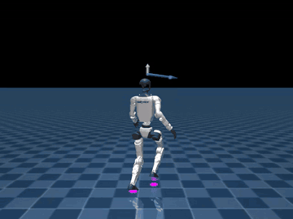
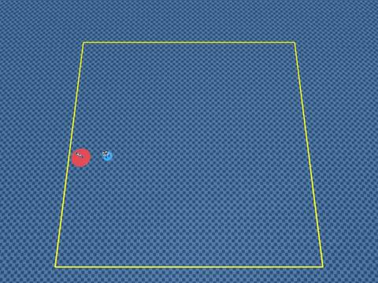
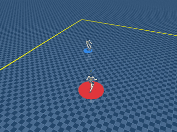
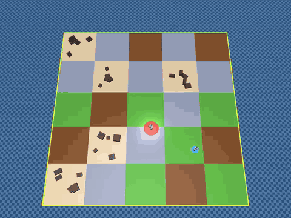
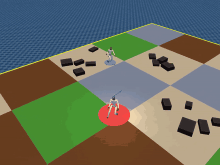

# Humanoid locomotion: PPO from scratch, from walking to playing tag

A Unitree G1 humanoid robot (29 joints) learns to walk, then to sprint at 5 m/s. Then two of
them play a zero-sum game of tag against each other. All of it is trained with a PPO
implementation written from scratch (`ppo.py`, about 370 lines, no RL library).
[mjlab](https://github.com/mujocolab/mjlab) (MuJoCo Warp, thousands of robots in parallel on
the GPU) is used only as the physics simulator.

Everything was trained on a laptop with an RTX 3050 (4 GB). The path to the final policies
took about 5.6 hours of training.

| Sprinting at 5 m/s | Tag, seen from above |
|---|---|
|  |  |
| `g1_turn/model_4349` told to run straight at 5 m/s: it reaches 4.94 m/s and doesn't fall. | Learned vs learned. Blue disc: the runner. Red disc: the chaser's 0.8 m catch radius. Yellow: the 20 × 20 m arena. The chaser pins the runner against the right-hand wall, and the runner steps out and loses. |

## Highlights

- **PPO from scratch.** It has an asymmetric actor-critic, observation normalization, GAE, a
  clipped surrogate and value loss, a KL-adaptive learning rate and timeout bootstrapping. It
  is written to be read top to bottom, with plain-language comments.
- **Walk → run → sprint.** A chain of training runs, each starting from an earlier checkpoint,
  takes the G1 from walking at 1 m/s to running at 4.96 m/s with zero falls.
- **Two reward traps found and fixed.** Told to run at 5 m/s, the policy learned to stand
  still. Later, it learned to stop turning. Both come from the same property of exponential
  tracking rewards, and both were fixed with a linear penalty.
  [`EXPERIMENTS.md`](EXPERIMENTS.md) has every number.
- **A two-player zero-sum Markov game.** Two G1s play runner vs chaser on top of the frozen
  running policy. One network learns both roles by self-play, and beats hand-written players
  on both sides.
- **A terrain arena.** An optional patchwork of grass, mud and rocky cells (`--terrain`), each
  with its own grip, softness and speed cap. The current policies can't see the terrain, and
  when they play on it, the rocks decide most games.
- **Getting back up.** With `--standup`, a frozen stand-up policy (HoST, trained separately
  on the same robot) takes over a fallen robot and hands it back to the legs once it stands.
  On the rocky arena, falls stop ending most games, and the learned strategies matter again.

## Contents

- [Repository layout](#repository-layout)
- [Quick start](#quick-start)
- [How it works](#how-it-works)
  - [The stack](#the-stack)
  - [The robot task](#the-robot-task)
  - [PPO from scratch](#ppo-from-scratch-ppopy)
  - [The adapter](#the-adapter-mjlab_envpy)
- [The training journey](#the-training-journey)
  - [Trap 1: standing still when told to sprint](#trap-1-standing-still-when-told-to-sprint)
  - [Trap 2: the legs stop turning](#trap-2-the-legs-stop-turning)
- [The tag game](#the-tag-game)
  - [Terrain arena: grass, mud and rocks](#terrain-arena-grass-mud-and-rocks-evaluation-only)
  - [Getting up after a fall](#getting-up-after-a-fall---standup)
- [Step-by-step training guide](#step-by-step-training-guide)
- [Command reference](#command-reference)
- [Known issues and next ideas](#known-issues-and-next-ideas)
- [References](#references)

## Repository layout

| file | lines | what it does |
|---|---|---|
| [`ppo.py`](ppo.py) | 368 | PPO for any vectorized environment: networks, rollouts, GAE, the update, the training loop, checkpoints |
| [`mjlab_env.py`](mjlab_env.py) | 240 | `MjlabEnv`: wraps mjlab's environment in the interface `ppo.py` expects; speed curricula, extra reward terms, fixed commands, video |
| [`train_walk.py`](train_walk.py) | 85 | Trains the locomotion policy ("the legs") |
| [`eval_walk.py`](eval_walk.py) | 72 | Counts falls, measures achieved vs commanded speed and turning, records a video |
| [`chase_env.py`](chase_env.py) | 338 | `ChaseEnv`: the runner vs chaser game on top of frozen legs, plus scripted players |
| [`train_chase.py`](train_chase.py) | 44 | Trains the game policy (both roles, one network) |
| [`eval_chase.py`](eval_chase.py) | 94 | Plays games (learned or scripted on either side), prints who wins and how, records a video |
| [`terrain.py`](terrain.py) | 236 | `TerrainArena`: the optional grass / mud / rocky patchwork arena for the game (`--terrain`) |
| [`eval_terrain.py`](eval_terrain.py) | 90 | The legs alone on each terrain type: falls, speed, turning, how far the feet sink |
| [`standup.py`](standup.py) | 296 | `Recovery`: a frozen stand-up policy gets fallen robots up again (`--standup`), switched in per robot |
| [`eval_standup.py`](eval_standup.py) | 140 | The stand-up policy with the legs, no game: robots dropped on their back or front, and robots tripping on rocks |
| [`EXPERIMENTS.md`](EXPERIMENTS.md) | | The lab notebook: every run, its flags, the evaluation numbers, and what went wrong |
| [`CLAUDE.md`](CLAUDE.md) | | Notes for AI coding assistants. They're also a good list of the non-obvious details for humans. |
| `docs/` | | The GIFs in this README |

`runs/` (TensorBoard logs and checkpoints) and `videos/` are git-ignored. `main.py` is an
unused stub from `uv init`.

## Quick start

**You need:**
- Linux with an NVIDIA GPU. The scripts use CUDA automatically when it's there. Everything here
  was trained on a 4 GB laptop GPU.
- [uv](https://docs.astral.sh/uv/). It installs Python 3.12 and the only direct dependency,
  `mjlab==1.6.0`, which brings MuJoCo, MuJoCo Warp, PyTorch and TensorBoard with it.

```bash
uv sync                                                                          # install into .venv
uv run python train_walk.py --num_envs 64 --iterations 2 --log_dir runs/smoke    # smoke test: does it run?
```

**Checkpoints aren't in git.** To watch the trained robots without training them yourself,
you need these two files, at these paths:
- `runs/g1_turn/model_4349.pt`: the legs, 5 MB
- `runs/chase/model_499.pt`: the game policy, 1 MB
- `runs/standup/model_11000.pt`: the stand-up policy, 21 MB (only for `--standup`). It was
  trained in a separate project, a port of [HoST](https://github.com/InternRobotics/HoST) to
  mjlab on the same G1.

Ask the author for them, or train them yourself with the
[step-by-step training guide](#step-by-step-training-guide). Then run:

```bash
# The legs: run straight at 5 m/s, print commanded vs achieved speed, save an mp4
uv run python eval_walk.py --checkpoint runs/g1_turn/model_4349.pt --speed 5 --video videos/sprint

# The game: learned runner vs learned chaser, 256 games, then a video of one game
uv run python eval_chase.py --checkpoint runs/chase/model_499.pt
uv run python eval_chase.py --checkpoint runs/chase/model_499.pt --video videos/chase                       # camera behind the chaser
uv run python eval_chase.py --checkpoint runs/chase/model_499.pt --video videos/chase_top --camera overhead  # whole arena from above
uv run python eval_chase.py --checkpoint runs/chase/model_499.pt --terrain --video videos/terrain --camera overhead  # on grass / mud / rocks

# Training curves
uv run tensorboard --logdir runs
```

## How it works

### The stack

```
  train_walk.py / eval_walk.py               train_chase.py / eval_chase.py
             │                                            │
             │                               chase_env.py (ChaseEnv: the game)
             │                               drives frozen legs from a walk checkpoint
             ▼                                            ▼
  mjlab_env.py (MjlabEnv: adapter, speed curricula, reward overrides, video)
             │
             ▼
  mjlab ManagerBasedRlEnv  ──►  MuJoCo Warp: thousands of robots stepped in parallel on the GPU

  ppo.py: knows nothing about robots. The train_* scripts hand it any env with reset() and step().
```

Each layer only talks to the one next to it. `ppo.py` never imports mjlab. Training the game
uses the same `ppo.train` as training the legs, unchanged.

### The robot task

The legs are trained on mjlab's `Mjlab-Velocity-Flat-Unitree-G1` task: follow a velocity
command on flat ground.

- **Command:** forward speed, sideways speed, and turning rate. A new random command is drawn
  every 3-8 s, and a curriculum widens the range during training.
- **Action:** 29 joint position targets, 50 times per second. The physics runs at 200 Hz
  (4 steps per action), and the simulated motors track the targets.
- **Actor input (99 numbers):** body velocity (3), body turning rates (3), the direction of
  gravity in the body frame (3), joint positions (29), joint velocities (29), the previous
  action (29), and the command (3).
- **Critic input (111 numbers):** the same, plus 12 "privileged" numbers a real robot couldn't
  easily measure: foot heights, foot air times, foot contacts and contact forces.
- **Reward:** mjlab's terms.
  - Velocity tracking: forward and sideways (weight 2) and turning (weight 2).
  - Staying upright (1) and staying near a natural pose (1).
  - Small penalties for jerky actions, foot slip, low foot clearance, joint limits, self-collision and body wobble.

  Every weight is multiplied by the 0.02 s step.
- **Episodes** last 20 s and end early if the robot tilts more than 70° (a fall).
- **Domain randomization:** random pushes, foot friction, joint encoder offsets and
  centre-of-mass shifts, so the policy doesn't overfit one exact robot.

### PPO from scratch (`ppo.py`)

The file is meant to be read in order:

| section | what it does |
|---|---|
| 1. `RunningNorm` | Normalizes every input to mean 0, std 1, with running statistics. Joint velocities are around 10 and contact forces around 500, and networks learn much better when every input has a similar scale. |
| 2. `ActorCritic` | Two MLPs (ELU, 512-256-128). The actor gives a Gaussian over actions with a learned noise level per joint, and the critic predicts the expected future reward. |
| 3. `collect_rollout` | Every robot acts for 24 steps, and everything is recorded. |
| 4. `compute_gae` | Turns rewards into advantages ("was this action better than the critic expected?") with Generalized Advantage Estimation. |
| 5. `ppo_update` | 5 epochs × 4 minibatches of the clipped surrogate loss, a clipped value loss and an entropy bonus. |
| 6. `train` | The outer loop: logging to TensorBoard and the console, and checkpoints every 50 iterations. |

The environment only has to provide this interface, with a leading `num_envs` dimension on
every tensor, and it must reset finished episodes itself:

```python
actor_obs, critic_obs = env.reset()
actor_obs, critic_obs, reward, terminated, truncated, info = env.step(actions)
```

A few details that matter:

- **Asymmetric actor-critic.** The actor only sees what a real robot could measure. The critic
  is only used during training, so it may also see simulator-only information. Each network
  has its own `RunningNorm`.
- **Timeout bootstrapping.** When an episode is cut off by the time limit (`truncated`), the
  robot didn't fail: it would have kept collecting reward. So `γ × V(s)` is added to the last
  reward, and the timeout isn't punished as if it were a fall.
- **KL-adaptive learning rate.** After every minibatch, the KL divergence between the old and
  new policy is measured. If it is above 0.02, the learning rate is divided by 1.5. If it is
  below 0.005, the learning rate is multiplied by 1.5. The rate stays between 1e-5 and 1e-2.
- **Checkpoints** store the network, optimizer, learning rate, iteration, config and input
  sizes. `load_actor_critic` can rebuild the policy from the file alone, without creating an
  environment.

Hyperparameters (`PPOConfig`; the defaults copy mjlab's own config for this task):

| | value | | value |
|---|---|---|---|
| steps per robot per update | 24 | discount γ | 0.99 |
| epochs × minibatches | 5 × 4 | GAE λ | 0.95 |
| clip range | 0.2 | entropy bonus | 0.01 |
| learning rate (start) | 1e-3, adaptive | target KL | 0.01 |
| hidden layers | 512, 256, 128 | initial action std | 1.0 |
| gradient clipping | 1.0 | value loss weight | 1.0 |

### The adapter (`mjlab_env.py`)

`MjlabEnv` builds mjlab's environment and returns the `"actor"` and `"critic"` observation
groups. It passes mjlab's per-episode logs (falls, each reward term, the curriculum level) to
`ppo.py` as `info`. Before the environment is built, it can edit the task config:

- **Speed curricula.**
  - `--stage_iters A B` uses mjlab's 1 → 2 → 3 m/s ladder, starting at iterations A and B.
    mjlab's own defaults are iterations 5000 and 10000, so a normal-length run never trains
    above 1 m/s.
  - `--speed_stages 0:4 300:5` goes to any top speed.
- **Extra reward terms.**
  - A fall penalty.
  - A looser pose for running joints.
  - `speed_shortfall` and `yaw_error`: the two fixes described below.
- **Fixed commands** for evaluation (`--speed`, `--turn`).
- **Game support.** mjlab never changes the commands. `set_command` writes them directly, and
  `place_robots` puts robots at chosen positions and headings.

`play=True` loads the evaluation version of the task, with no pushes, no sensor noise and no
time limit. That's how `eval_walk.py` counts every episode end as a fall.

## The training journey

Each run continues from a checkpoint of the one before. Speeds below are from
`eval_walk.py --speed V`: 64 robots, 20 s each, the first 2 s after every spawn skipped.
"Falls" means falls per robot-minute.

| run | starts from | what changed | result | training time |
|---|---|---|---|---|
| `g1_walk` | scratch | mjlab defaults, 4096 robots, 1500 iterations | walks; 0.93 m/s at a 1 m/s command (it was never commanded faster) | 66 min |
| `g1_run` | `g1_walk/1499` | commands up to 3 m/s (`--stage_iters 0 500`), a fall penalty, a looser running pose | 2.98 m/s @ 3, 3.89 @ 4, 0 falls | 68 min |
| `g1_sprint` | `g1_run/2999` | 8192 robots, commands up to 4, then 5 m/s | **stands still** at 4-5 m/s ([trap 1](#trap-1-standing-still-when-told-to-sprint)) | 78 min |
| `g1_sprint2` | `g1_run/2999` | same + `--speed_shortfall -1` | **5.05 m/s @ 5**, 0 falls, but it can't turn | 78 min |
| `g1_turn` | `g1_sprint2/3999` | + `--yaw_error -1` | 4.96 m/s @ 5, 0 falls, turns at 0.12-0.22 rad/s; got worse after iteration 4400, so **`model_4349`** is the one to use ([trap 2](#trap-2-the-legs-stop-turning)) | 39 min |

The final path (walk → run → sprint2 → turn) is about 590 million simulation steps, or about
136 days of robot experience, in 4.2 hours.

### Trap 1: standing still when told to sprint

`g1_sprint` tracked 3 m/s perfectly. Told to go 5 m/s, it planted its feet and stood still:
no falls, no progress. The training curves showed nothing wrong, because they average over
all commands.

**Why.** mjlab's speed reward is `exp(-error² / 0.25)`. That pays almost nothing once the
robot is more than about 1 m/s off the command. Jogging at 3 m/s when told 5 earns the same
~0 as standing. Meanwhile, a robot standing still earns the upright, pose and turning rewards
almost for free, and pays no foot or action costs. Reward per second at a 5 m/s command:

| | running at 4.43 m/s | standing still |
|---|---|---|
| speed tracking | 0.37 | 0.00 |
| everything else | 0.86 | 3.86 |
| **total** | **1.23** (plus falls) | **3.86** |

Standing is simply the better deal, and nothing between standing and nearly 5 m/s gives a
signal that would lead the policy out of it.

**Fix: `--speed_shortfall`.** This adds a linear penalty per m/s of missing speed:
`max(0, |command| − velocity along the command)`. Every m/s costs the same, so there is
always a gradient toward the commanded speed. With a weight of -1, the totals flip, and
`g1_sprint2` (the same run plus this penalty) reaches **5.05 m/s with 0 falls**.

### Trap 2: the legs stop turning

When the game's robots couldn't steer, it turned out that `g1_sprint2` ignores turning
commands entirely: the yaw rate is 0.00 for a 0.7 rad/s command. Turning had been fading over
the whole run history.

**Why: the same exp() trap.** mjlab's turning reward is
`exp(-(yaw error² + roll rate² + pitch rate²) / 0.5)`. A running torso rocks in roll and
pitch, which alone pushes the reward close to 0. So turning or not barely changes the reward.

**Fix: `--yaw_error`.** This adds a linear penalty on |commanded − actual yaw rate| that
ignores roll and pitch. It only partly worked:
- `g1_turn` turns at 0.12-0.22 rad/s, about a third of the command.
- Late in the run (after iteration 4400), it started falling constantly, so `model_4349` is
  the checkpoint to use.

**Lessons**
- Exponential tracking rewards give no learning signal far from the target. When the target
  is out of reach, the policy settles for whatever else pays. A linear penalty keeps pushing.
- Training curves average over every command. After changing rewards, check each command
  axis separately (`eval_walk.py --speed 5`, `--turn 0.7`).
- Check several checkpoints. The last one isn't always the best.

## The tag game



*Camera behind the chaser (red disc), looking toward the runner (blue). The runner reaches the
wall and steps out, and a new game starts.*

### Rules

- Two G1s in a 20 × 20 m arena.
- The **chaser wins** if the two pelvises come within 0.8 m.
- The **runner wins** if it isn't caught within 20 s.
- A robot that **falls** or **leaves the arena** loses. If both do it on the same step, it's
  a draw. With [`--standup`](#getting-up-after-a-fall---standup), a robot that falls gets up
  again, and loses only if it isn't standing 5 s after a 0.6 s settle.
- The rules are checked after every 0.02 s control step.

### Design

- **Strategy only.** The legs (`g1_turn/model_4349`) are frozen. They turn a velocity command
  into joint targets. The game policy only picks the command, 10 times per second:
  - forward speed from -2 to 5 m/s;
  - sideways speed from -1 to 1 m/s;
  - turning rate from -0.7 to 0.7 rad/s.

  These are the ranges the legs were trained on.
- **Ghost robots.** Each robot lives in its own mjlab world, so the two never physically touch.
  A catch is a tag, not a tackle. All worlds share one coordinate frame, with the arena
  centred at (0, 0). 2048 games (4096 robots) run in parallel.
- **One network, both roles.** An input says which role the robot has (+1 chaser, -1 runner).
  The env exposes 2 agents per game, so `ppo.train` works unchanged.
- **Pure self-play.** During training, both robots in every game are driven by the current
  network. There are no scripted opponents and no older copies of the policy.
- **Actor input (23 numbers, in the robot's own frame):**
  - its role and the fraction of game time left;
  - where the opponent is (x, y, distance) and which way it faces;
  - its own velocity and turning rate, and the opponent's;
  - the direction to the arena centre, its own distance to the nearest wall, and the
    opponent's distance to the nearest wall;
  - its own last command and its tilt.
- **Critic input (29 numbers):** the actor input, plus the opponent's tilt and current command.
- **Zero-sum reward:** +10 for the winner and -10 for the loser (0 each for a draw). On top of
  that, a shaping reward each decision: the chaser gets +1 per metre it closes, and the runner
  gets the opposite. The two players' rewards always sum to 0. That's why the logged mean
  return is about 0 by construction, and the win rates are the numbers to watch.
- **The 20 s limit is a rule, not a cut-off.** The time left is part of the input, so the end
  is a real terminal state, not a truncation.
- **PPO settings:** γ = 0.995 (a game is up to 200 decisions), a smaller 256-128 network,
  initial action std 0.5.
- **Scripted baselines, for evaluation only.** These are never used in training:
  - `pursue` runs at full speed toward where the runner will be, up to 1 s ahead.
  - `flee` runs away from the chaser, with a push away from the walls.
  - Both slow down before walls.

### Results

Training took 500 iterations, 85 minutes (10.2 s per iteration, 1.3 GB of GPU memory).
256 games each, using the policy's mean action:

| chaser vs runner | caught | time up (runner wins) | runner fell | chaser fell | runner out | chaser out |
|---|---|---|---|---|---|---|
| scripted `pursue` vs scripted `flee` (baseline) | 27.7% | 68.0% | 1.6% | 2.3% | 0.0% | 0.4% |
| **learned** chaser vs `flee` | **87.9%** | 5.9% | 2.7% | 0.8% | 0.0% | 2.7% |
| `pursue` vs **learned** runner | 3.5% | **77.7%** | 2.0% | 2.0% | 14.8% | 0.0% |
| learned vs learned | 42.6% | 9.4% | 4.3% | 5.5% | 37.1% | 1.2% |

- **Both learned roles beat the scripted ones.**
  - The learned chaser catches `flee` 88% of the time, where `pursue` catches it 28%.
  - The learned runner survives `pursue` 78% of the time, where `flee` survives 68%.
- **The runner's weak spot is the walls.** The legs turn at about 0.2 rad/s, so at 5 m/s
  their turning circle is wider than the arena. A runner fleeing at full speed can't steer
  away from a wall in time.
- **The learned chaser exploits that.** Against the learned runner, 37% of games end with the
  runner pushed out of the arena. That's what both GIFs above show.
- **Self-play win rates swing a lot during training** (the chaser's win rate moved between 24%
  and 57%). That's normal for self-play, so progress is judged against the scripted players.

Game settings are flags: `--arena`, `--catch_radius`, `--game_s` (a longer game) and
`--shaping`.

### Terrain arena: grass, mud and rocks (evaluation only)



*Grey: normal ground. Green: grass. Brown: mud. Sand with dark boxes: rocky. Every game draws a
new layout. The first game ends in a catch. In the second, a robot runs into a rocky cell and
trips.*

`--terrain` turns the arena into a 5 × 5 patchwork of 4 m cells:
- 5 normal, 6 grass, 6 mud and 8 rocky cells (20/24/24/32%);
- no two side-by-side cells of the same type;
- a new random layout every game.

Each terrain type changes the physics, and also caps the forward command as a game rule:

| terrain | grip | softness | extra | speed cap |
|---|---|---|---|---|
| normal | as on the flat arena | none | | 5 m/s |
| grass | 0.5 | feet sink 0.4 cm | | 4 m/s |
| mud | 0.4 | feet sink 1 cm | drag pulls the robot back | 2 m/s |
| rocky | as normal | none | 5 solid rocks per cell, 8-30 cm tall | 3 m/s |

Nothing was retrained. These are the current legs and game policy, and neither can see the
terrain:
- **Grass and mud are survivable at their speed caps.** In mud at 5 m/s, though, 72-84% of
  robots fall.
- **Rocks decide the game.** The blind legs trip over rocks at any speed (61-94% of robots
  running through a rocky lane fall).
- In the game, 94-98% of the falls happen on rocky cells. Almost no game lasts the full 20 s.

**Old vs new layout.** The arena first had 8 normal and 5 rocky cells, and the generator
crowded the most common type into one side of the grid. Now it has 5 normal and 8 rocky cells,
spread evenly. With the same policies and 1024 games per match-up, the share of games ending
each way:

| chaser vs runner | caught | time up | someone fell | chaser wins, any way |
|---|---|---|---|---|
| `pursue` vs `flee` | 14.5 → 12.0 | 6.6 → 1.6 | 78.6 → 86.4 | 60.2 → 59.3 |
| learned vs `flee` | 44.0 → 31.0 | 2.2 → 0.6 | 52.5 → 67.8 | 75.7 → 71.6 |
| `pursue` vs learned | 1.6 → 1.1 | 11.2 → 3.2 | 78.1 → 90.0 | 53.1 → 51.8 |
| learned vs learned | 16.9 → 10.9 | 1.3 → 0.5 | 68.4 → 80.0 | 71.3 → 67.7 |

- **Falls replace catches and time-ups.** Robots spend 17-22% of their time on rocky cells
  instead of 11-14%, and that's where they fall.
- **Who wins hardly changes:** at most 4 points. Both robots are blind, so the rocks trip both
  sides alike. They decide more games but favour neither role.
- **The extra rocky cells did it, not the layout fix.** Running all four combinations, the fix
  alone moves falls by less than 2 points on the 8-rocky layout.

The fix would be to give the game policy the terrain around it and retrain it with
`--terrain`. `EXPERIMENTS.md` has all the numbers, plus three MuJoCo Warp pitfalls hit while
building this:
- the feet's contact priority;
- box tiles tripping robots at their seams;
- world-fixed geoms that can't move per world.

```bash
uv run python eval_terrain.py                                                   # the legs on each terrain
uv run python eval_chase.py --checkpoint runs/chase/model_499.pt --terrain      # the game on terrain
uv run python eval_chase.py --checkpoint runs/chase/model_499.pt --terrain --video videos/terrain --camera overhead
```

### Getting up after a fall (`--standup`)



*Camera behind the chaser (red disc). The runner trips into a pile of rocks, lies there, gets
up in about 2 s and runs on, and the chaser catches it a moment later.*

On the terrain arena, most games ended with a fall. `--standup CKPT` makes a fall cost time
instead: a stand-up policy takes over the fallen robot, gets it up, and hands it back to the
legs. A robot that isn't standing 5 s after a 0.6 s settle loses (`--standup_s`).
- **The stand-up policy** comes from a separate project: [HoST](https://github.com/InternRobotics/HoST)
  (RSS 2025), ported to mjlab on the same G1 and trained to get up from lying on its back on
  rocky ground. Here it's frozen, like the legs.
- **Each robot has a state machine:** walk → tilted past 70° → the stand-up policy → upright
  for 0.4 s → the legs, told to stand still for 0.5 s → walk.
- **The stand-up policy has its own control law, joint damping and inputs,** so the switch
  swaps all three, per robot (`standup.py`). Get any of them wrong and it quietly fails to
  stand. [`CLAUDE.md`](CLAUDE.md) lists the pitfalls.

**Without a game** (`eval_standup.py`): dropped on its back, the robot gets up 100% of the
time, in about 2 s. Dropped on its front, 89% in time, in about 4.5 s. Tripping on rocks is
harder. The robots mostly land face down among the rocks, and 63-98% get up, depending on how
they lie. At 3-5 m/s, a fifth to a quarter of falls are followed by another within 2 s of
getting up, because the robot sets off at full speed into the same rocks.

**In the game.** 20 s games on the terrain arena, 1024 per row, the same policies as above.
Each cell shows without → with stand-up. "Ended by a fall" means the robot fell (without) or
gave up getting up (with):

| chaser vs runner | caught | time up | ended by a fall | chaser wins, any way |
|---|---|---|---|---|
| `pursue` vs `flee` | 10.6 → 33.1 | 1.1 → 30.4 | 88.2 → 34.9 | 58.7 → 50.5 |
| learned vs `flee` | 30.8 → 67.9 | 0.5 → 10.8 | 68.2 → 19.3 | 70.5 → 78.3 |
| `pursue` vs learned | 1.1 → 7.0 | 2.1 → 49.9 | 91.1 → 33.6 | 54.4 → 30.7 |
| learned vs learned | 10.5 → 48.4 | 1.0 → 20.0 | 79.7 → 17.9 | 67.8 → 68.6 |

- **Falls stop deciding the game.** Catches and time-ups come back. Each robot still falls
  0.6-1.0 times per game and gets up from 74-85% of its falls, in about 3.5 s.
- **The learned policies' edge shows again.** Against `flee`, the learned chaser wins 28 points
  more often than `pursue` (12 without stand-up). Against `pursue`, the learned runner cuts the
  chaser's wins by 20 points (4 without).
- **Game length now matters.** Without stand-up, almost no game reaches 20 s, so 60 s games
  change nothing. With stand-up, 60 s games cut the runner's wins by 6-24 points: it has to
  last three times as long while falling about once per game. The learned runner, trained on
  20 s games, loses 6 points more than the scripted `flee`, mostly by leaving the arena.

[`EXPERIMENTS.md`](EXPERIMENTS.md) has the full tables, the 60 s games and the trip test.

```bash
uv run python eval_standup.py                                                    # drops and trips, no game
uv run python eval_chase.py --checkpoint runs/chase/model_499.pt --terrain --standup runs/standup/model_11000.pt
uv run python eval_chase.py --checkpoint runs/chase/model_499.pt --terrain --standup runs/standup/model_11000.pt --video videos/standup --game_s 40
```

## Step-by-step training guide

This section repeats the whole pipeline, stage by stage, with the exact commands. Each stage
starts from the last good checkpoint of an earlier one (`--resume`) and runs a number of extra
iterations. Iteration numbers continue across stages, so `g1_run` saves `model_1549.pt` …
`model_2999.pt`. Times are on an RTX 3050 Laptop GPU (4 GB).

```
 Step 1      Step 2       Step 3          Step 4                       Step 5
 g1_walk ──► g1_run ──►   g1_sprint2 ──►  g1_turn ──► pick model_4349 ──► chase (the game)
 0-1499      1500-2999    3000-3999       4000-4499                     0-499
 66 min      68 min       78 min          39 min                        85 min
 walk 1 m/s  run 3 m/s    sprint 5 m/s    turn again                    runner vs chaser
                  │
                  └──► g1_sprint (the same as step 3 without the fix: stands still at 5 m/s)
```

### Reading the training output

`train_walk.py` prints one line per iteration. This is the last one of `g1_run`:

```
it  2999 | return    36.10 | ep len 1000.0 | std 0.47 | lr 7.6e-05 | fell_over 0.136 | track_linear_velocity 1.323 | lin_vel_x_max 3.000 | 2.62s/it (collect 2.11s) | ETA 22.5 min
```

| field | meaning | what you want to see |
|---|---|---|
| `return` | mean total reward of recently finished episodes | going up. It can't be compared between stages, because each stage changes the rewards. |
| `ep len` | mean length of finished episodes, in 0.02 s steps (1000 = the full 20 s) | close to 1000 |
| `std` | the actions' exploration noise | shrinking slowly. It rises for a while when a stage brings new commands. |
| `lr` | the adaptive learning rate | anywhere between 1e-5 and 1e-2 is normal |
| `fell_over` | robots that fell, counted at each reset (`Episode_Termination/fell_over`) | close to 0 |
| `track_linear_velocity` | speed-tracking reward per second of episode (maximum 2.0) | going up |
| `lin_vel_x_max` | the curriculum's current top forward speed | follows the stages you asked for |

TensorBoard (`uv run tensorboard --logdir runs`, then open http://localhost:6006) has the same
numbers, plus every `Episode_Reward/<term>`, `kl`, and the PPO losses.

> **Ignore the first ~40 iterations after a `--resume`.** An episode lasts 1000 steps, about
> 42 iterations. Until then, the only episodes that have finished are the ones that ended in
> a fall, so `ep len` looks short, `return` looks low and `fell_over` looks high.

### Step 0: install and check

```bash
uv sync
uv run python train_walk.py --num_envs 64 --iterations 2 --log_dir runs/smoke
```

This prints two `it` lines and saves `runs/smoke/model_1.pt`. If it does, everything is set up.

### Step 1: walk (`g1_walk`)

**Goal:** go from random weights to a stable walk.

```bash
uv run python train_walk.py        # 4096 robots, 1500 iterations -> runs/g1_walk (66 min)
```

- **No flags:** this is mjlab's task as it is. Commands are forward and sideways speeds from
  -1 to 1 m/s and a turning rate from -0.5 to 0.5 rad/s, with a new command every 3-8 s. Some
  robots are told to stand still (10%), and some to turn toward a target heading.
- **This run never goes faster than 1 m/s.** mjlab's own curriculum would raise the speed at
  iterations 5000 and 10000, which this run doesn't reach.

**What the training curves did:**

| | start | end |
|---|---|---|
| `ep len` | ~50 (falls right away) | ~1000 (reached by iteration ~750) |
| `fell_over` | 68 | 0.02 |
| `track_linear_velocity` | 0.02 | 1.55 |
| `std` | 1.0 | 0.35 |

**Check it:**

```bash
uv run python eval_walk.py --checkpoint runs/g1_walk/model_1499.pt             # random commands: count falls
uv run python eval_walk.py --checkpoint runs/g1_walk/model_1499.pt --speed 1
uv run python eval_walk.py --checkpoint runs/g1_walk/model_1499.pt --speed 3
```

**Result:**
- 0.93 m/s at a 1 m/s command, 1.77 at 2, and 2.26 at 3.
- At 3 m/s it falls a lot (59 falls per robot-minute). It was never trained that fast.

### Step 2: run (`g1_run`)

**Goal:** faster commands, up to 3 m/s.

```bash
uv run python train_walk.py --resume runs/g1_walk/model_1499.pt --log_dir runs/g1_run --iterations 1500 \
  --stage_iters 0 500 --fell_over -200 --pose_running_scale 1.5
```

- **`--stage_iters 0 500`** brings mjlab's speed ladder forward:
  - from iteration 0 of this run: forward commands from -1.5 to 2 m/s, turning ±0.7 rad/s;
  - from iteration 500: forward commands from -2 to 3 m/s.

  The ladder counts iterations from the start of this run, not the checkpoint's number. A new
  stage reaches each robot at its next reset.
- **`--fell_over -200`** adds a penalty of 4 per fall (×0.02). mjlab's task has no explicit
  fall penalty, and running makes falling easier.
- **`--pose_running_scale 1.5`** gives the running joints more room. mjlab's pose reward keeps
  joints near a default pose, with a wider tolerance once the command is 1.5 m/s or more.
  This flag widens that running tolerance 1.5× for hip pitch, knees, shoulders and elbows,
  which allows longer strides and a bigger arm swing.

**What the training curves did:**
- `lin_vel_x_max` went from 2 to 3 at iteration 2000.
- `fell_over` ended at 0.16, and `track_linear_velocity` at 1.29.
- `std` rose from 0.35 to 0.47 while it explored the new speeds.
- `Episode_Reward/track_angular_velocity` dropped from 0.46 (mid-run) to 0.38. Looking back,
  this was the first sign of [trap 2](#trap-2-the-legs-stop-turning).

**Check it:**

```bash
for v in 3 4 5; do uv run python eval_walk.py --checkpoint runs/g1_run/model_2999.pt --speed $v; done
```

**Result:**
- 2.98 m/s at 3 and 3.89 at 4, with 0 falls.
- 4.41 at 5, with 4.2 falls per robot-minute.
- It was never trained above 3 m/s, so this is the starting point for sprinting.

### Step 3: sprint to 5 m/s (`g1_sprint2`)

**Goal:** commands up to 5 m/s.

```bash
uv run python train_walk.py --resume runs/g1_run/model_2999.pt --log_dir runs/g1_sprint2 \
  --num_envs 8192 --num_minibatches 8 --iterations 1000 \
  --speed_stages 0:4 300:5 --fell_over -200 --pose_running_scale 1.5 --speed_shortfall -1
```

- **`--num_envs 8192 --num_minibatches 8`:** twice the robots, for more varied data per
  update. 8 minibatches keep each minibatch the same size as before (24 × 8192 / 8 = 24,576
  samples). This takes 4.7 s per iteration and fits in 4 GB.
- **`--speed_stages 0:4 300:5`:** forward commands up to 4 m/s straight away, then up to 5 m/s
  from iteration 300. Backward up to 2 m/s, turning ±0.7 rad/s.
- **`--speed_shortfall -1`** is the fix for [trap 1](#trap-1-standing-still-when-told-to-sprint).
  The same command without this flag is `g1_sprint`, which learns to stand still at 4-5 m/s.

**What the training curves did:**
- `lin_vel_x_max` went from 4 to 5 at iteration 3300.
- `return` turned negative (about -15). This is expected: the new penalty is never positive.
- `fell_over` settled around 0.8. It's higher than in step 2, because the robot really runs
  at 5 m/s now.
- `std` rose from 0.47 to 0.71.

> **The curves can't tell a sprinter from a robot standing still.** The failed `g1_sprint`
> looks *better* than this run on every curve: return 28 vs -15, `fell_over` 0.13 vs 0.87,
> `track_linear_velocity` 1.12 vs 1.02. Only an evaluation at the top speed shows the
> difference, so always run it.

**Check it:**

```bash
uv run python eval_walk.py --checkpoint runs/g1_sprint2/model_3999.pt --speed 5
uv run python eval_walk.py --checkpoint runs/g1_sprint2/model_3999.pt --turn 0.7       # turn in place
uv run python eval_walk.py --checkpoint runs/g1_sprint2/model_3999.pt --speed 3 --turn 0.7
```

**Result:**
- **5.05 m/s at 5**, 4.08 at 4 and 3.04 at 3, with 0 falls.
- It **doesn't turn**: 0.00 rad/s for a 0.7 rad/s command. That's
  [trap 2](#trap-2-the-legs-stop-turning), and step 4 fixes it.

### Step 4: turn again (`g1_turn`)

**Goal:** get turning back without losing speed.

```bash
uv run python train_walk.py --resume runs/g1_sprint2/model_3999.pt --log_dir runs/g1_turn \
  --num_envs 8192 --num_minibatches 8 --iterations 500 \
  --speed_stages 0:5 --fell_over -200 --pose_running_scale 1.5 --speed_shortfall -1 --yaw_error -1
```

- **`--speed_stages 0:5`:** the full speed range from the start, because the robot already
  sprints.
- **`--yaw_error -1`:** the fix for trap 2, a linear penalty per rad/s of turning error.

**What the training curves did:**
- `Episode_Reward/track_angular_velocity` went from 0.06 to 0.10, so turning is coming back.
- Near the end it went wrong. Between iterations 4400 and 4499:
  - `fell_over` rose from about 1.2 to 5;
  - `ep len` dropped from about 930 to 705.

  The last checkpoint is broken, so pick an earlier one.

**Pick the checkpoint.** Evaluate the last few checkpoints at top speed and while turning:

```bash
for it in 4249 4299 4349 4399 4449 4499; do
  echo "== model_$it"
  uv run python eval_walk.py --checkpoint runs/g1_turn/model_$it.pt --speed 5 | grep -E "^falls|forward"
  uv run python eval_walk.py --checkpoint runs/g1_turn/model_$it.pt --speed 3 --turn 0.7 | grep -E "^falls|turning"
done
```

| checkpoint | 5 m/s straight | 3 m/s + turn 0.7 |
|---|---|---|
| `model_4249` | 4.92 m/s, 0.7 falls | 0.20 rad/s |
| **`model_4349`** | **4.96 m/s, 0 falls** | **0.22 rad/s** |
| `model_4399` | 4.99 m/s, 10.5 falls | |
| `model_4499` (last) | 254 falls | 0.22 rad/s |

`model_4349` is the legs for the game. It turns at only about a third of the command, so the
robots in the game turn slowly.

### Step 5: the runner vs chaser game (`chase`)

**5a. Check the legs can play.** Before training, pit the two scripted players against each
other:

```bash
uv run python eval_chase.py --runner flee --chaser pursue --legs runs/g1_turn/model_4349.pt
```

- Expect about 28% caught and 68% time up.
- With legs that can't turn (`g1_sprint2/model_3999`), this gives 92% runner wins and 8%
  catches. That's a sign the robots can't steer, and the game isn't worth training on them.

**5b. Train** (2048 games = 4096 robots, 500 iterations, 85 min):

```bash
uv run python train_chase.py --legs runs/g1_turn/model_4349.pt      # -> runs/chase
```

**How the game is trained: pure self-play, no scripted players.**

```
            one game policy (random weights at the start, trained by PPO)
                 │ role = -1                               │ role = +1
                 ▼                                         ▼
          runner command                            chaser command        every 0.1 s, with exploration noise
                 │                                         │
                 ▼                                         ▼
    frozen legs (g1_turn/model_4349)         frozen legs (g1_turn/model_4349)
                 │                                         │
                 ▼                                         ▼
        runner robot, world i                  chaser robot, world 2048+i
                 └──────────── rules + zero-sum reward ────┘
```

- **The same network drives both robots in every game, and nothing else does.** The
  scripted `pursue` and `flee` are never used in training. Only the game policy learns; the
  legs stay fixed.
- **It starts from random weights.** At first, both robots wander about with random
  commands, so most games end with someone walking out of the arena (`runner_out` 41%).
- **One iteration is 24 decisions (2.4 s of game time) in each of the 2048 games.**
  - That's 4096 × 24 = 98,304 samples.
  - Half come from the runner's side and half from the chaser's. All of them update the
    same weights in the same PPO step.
  - Because the reward is zero-sum, the runner's samples teach the network to escape, and
    the chaser's samples teach it to catch.
- **Games restart independently.** A game that ends is restarted right away with new random
  start positions. So a 24-decision rollout can span several games, and `terminated` stops
  the advantage estimate at each game's end.
- **The opponent is always the current version of the policy.** There's no frozen copy and
  no pool of older checkpoints. When the chaser side gets better, the runner side has to
  catch up, and the other way round.
- **That's why win rates in the training log move back and forth and can't measure
  progress.** If both sides improve equally, the win rate stays flat. So progress is
  measured in 5c, against the scripted players, which stay the same throughout.

**Why not train against the scripted players instead?** A learner trained against one fixed
opponent only learns to beat that opponent. With self-play, the opponent keeps getting
better, and one network learns both roles. The usual risk is cycling: a side forgets how to
beat an older strategy. The standard fix is to also play against a pool of older
checkpoints. That isn't implemented yet (see [known issues](#known-issues-and-next-ideas)).

**What the training curves did:**
- `Game/chaser_win` went from 6% to 37% and `Game/length_s` from 4.7 s to 9.9 s, as the
  runner learned to survive longer and the chaser learned to catch.
- `Game/runner_out` stayed around 40%: the runner never fixed its wall problem.
- `return` stays near 0 by construction (zero-sum, one network), so don't use it.
- `std` grew from 0.5 to 1.03 (see [known issues](#known-issues-and-next-ideas)).
- Win rates swing between the roles: the chaser's moved between 24% and 57%. That's the
  self-play back-and-forth described above.

**5c. Evaluate against the scripted players.** This is the real measure of progress:

```bash
for it in 249 499; do
  uv run python eval_chase.py --checkpoint runs/chase/model_$it.pt --runner flee      # how good is the chaser?
  uv run python eval_chase.py --checkpoint runs/chase/model_$it.pt --chaser pursue    # how good is the runner?
done
uv run python eval_chase.py --checkpoint runs/chase/model_499.pt                     # learned vs learned
```

`model_499`'s learned chaser catches `flee` 88% of the time, and its learned runner survives
`pursue` 78% of the time. The full table is in [Results](#results).

**5d. Watch a game:**

```bash
uv run python eval_chase.py --checkpoint runs/chase/model_499.pt --video videos/chase                         # behind the chaser
uv run python eval_chase.py --checkpoint runs/chase/model_499.pt --video videos/chase_top --camera overhead   # the whole arena
uv run python eval_chase.py --checkpoint runs/chase/model_499.pt --video videos/chase_60s --game_s 60         # a longer game
```

### Tips

- **Resuming:**
  - `--resume` restores the network, the optimizer, the learning rate and the iteration count.
  - `--iterations` counts *extra* iterations.
  - Task and reward flags aren't stored in checkpoints, so pass them again. Each run's flags
    are in `<log_dir>/args.jsonl`.
- **Restarting a crashed run:** resume from its last checkpoint (one is saved every 50
  iterations). The speed curriculum counts from the start of each process, so shift the
  stages. For example, resuming step 3 after iteration 300 should use `--speed_stages 0:5`.
- **Out of GPU memory:** halve `--num_envs` and `--num_minibatches` together. Each minibatch
  keeps the same size.
- **A rerun won't reproduce these numbers exactly.** GPU simulation isn't bit-for-bit
  deterministic, so evaluate a few checkpoints at every stage. The best one may not be
  `model_4349`.
- **After any change to the rewards,** check every command axis: `--speed` at the top speed,
  `--turn 0.7`, and random commands.

## Command reference

### `train_walk.py` (the legs)

| flag | default | meaning |
|---|---|---|
| `--num_envs` | 4096 | robots simulated in parallel |
| `--iterations` | 1500 | PPO iterations to run (added on top when resuming) |
| `--log_dir` | `runs/g1_walk` | TensorBoard logs, checkpoints and `args.jsonl` |
| `--resume` | | checkpoint to continue from (model, optimizer, learning rate, iteration) |
| `--num_steps`, `--num_minibatches` | 24, 4 | PPO batch shape (use 8 minibatches with 8192 robots) |
| `--stage_iters A B` | | mjlab's speed ladder: up to 2 m/s from iteration A, 3 m/s from B |
| `--speed_stages ITER:VMAX ...` | | any speed ladder, e.g. `0:4 300:5` |
| `--fell_over` | | extra penalty per fall, e.g. `-200` (= -4 per fall) |
| `--pose_running_scale` | | loosen the running pose for hips, knees and arms, e.g. `1.5` |
| `--speed_shortfall` | | penalty per m/s slower than commanded, e.g. `-1` (trap 1) |
| `--yaw_error` | | penalty per rad/s of turning error, e.g. `-1` (trap 2) |
| `--air_time`, `--action_rate` | | weights of those mjlab reward terms |

Every run appends its flags to `<log_dir>/args.jsonl`, because checkpoints don't store them.

### `eval_walk.py`

| flag | meaning |
|---|---|
| `--checkpoint` | policy to run (required) |
| `--speed V` | every robot runs straight at V m/s; prints commanded vs achieved speed |
| `--turn W` | also turn at W rad/s (alone: turn in place); prints commanded vs achieved turning |
| `--num_envs`, `--seconds` | 64 robots, 20 s by default |
| `--video DIR` | record one robot to an mp4 |

Example output:

```
falls: 0  (0.00 per robot-minute)
mean reward per step: 0.060
forward speed (skipping first 2 s after each spawn): commanded 5.00 m/s | achieved 4.94 m/s
turning: commanded 0.00 rad/s | achieved 0.01 rad/s | mean error 0.23 rad/s
```

### `train_chase.py` and `eval_chase.py` (the game)

| flag | default | meaning |
|---|---|---|
| `--legs` | `runs/g1_turn/model_4349.pt` | frozen locomotion checkpoint |
| `--arena` | 20 | side of the square arena (m) |
| `--catch_radius` | 0.8 | pelvis distance that counts as a catch (m) |
| `--game_s` | 20 | the runner wins after this many seconds |
| `--shaping` | 1.0 | chaser reward per metre closed (the runner gets the opposite) |
| `--terrain` | off | the grass / mud / rocky patchwork arena, with a new layout every game |
| `--standup CKPT` | off | fallen robots get up again with this stand-up policy (e.g. `runs/standup/model_11000.pt`) |
| `--standup_s` | 5 | with `--standup`: a robot not standing this long after its 0.6 s settle loses |
| `--num_games` | 2048 (train), 256 (eval) | games at once, 2 robots each |
| `--iterations`, `--log_dir`, `--resume` | 500, `runs/chase` | training only |
| `--checkpoint` | | eval: the game policy |
| `--runner policy\|flee`, `--chaser policy\|pursue` | `policy` | eval: who plays each side |
| `--sample` | | eval: sample actions instead of using the mean |
| `--video DIR`, `--camera chaser\|overhead` | `chaser` | eval: record one game |

### `eval_standup.py` (getting up, no game)

| flag | default | meaning |
|---|---|---|
| `--standup` | `runs/standup/model_11000.pt` | stand-up checkpoint |
| `--legs` | `runs/g1_turn/model_4349.pt` | locomotion checkpoint |
| `--robots` | 256 | robots per test (the drop test puts half on their back, half on their front) |
| `--speeds` | 3 5 | speeds of the rocky-lane trip test (m/s) |
| `--standup_s` | 5 | time to get up after the 0.6 s settle |

### What to watch in TensorBoard

- **Legs:**
  - `Episode_Termination/fell_over`;
  - `Episode_Reward/<term>` for every reward term;
  - `Curriculum/command_vel/lin_vel_x_max` (the current top speed);
  - `kl`, `lr` and `action_std`.
- **Game:** `Game/chaser_win`, `Game/runner_win`, `Game/runner_out` and the other outcomes,
  plus `Game/length_s`, and with `--standup`, `Game/falls` (falls per robot and game). The
  game's `mean_return` is about 0 by construction.

### Recording and exporting videos

Both eval scripts record an MP4 with `--video FOLDER`, and print its path at the end.

```bash
# the legs: one robot, 640 × 480, --seconds long (default 20)
uv run python eval_walk.py --checkpoint runs/g1_turn/model_4349.pt --speed 5 --seconds 12 --video videos/sprint5
# the game: 960 × 720, --game_s long (default 20). A game that ends is followed by a new one.
uv run python eval_chase.py --checkpoint runs/chase/model_499.pt --video videos/game                       # behind the chaser
uv run python eval_chase.py --checkpoint runs/chase/model_499.pt --video videos/game_top --camera overhead  # whole arena
uv run python eval_chase.py --checkpoint runs/chase/model_499.pt --terrain --game_s 40 --video videos/terrain_40s --camera overhead
uv run python eval_chase.py --checkpoint runs/chase/model_499.pt --terrain --standup runs/standup/model_11000.pt --game_s 40 --video videos/standup  # falls and getting up
```

- **Where the file goes:** `FOLDER/rl-video-step-0.mp4`. The name is always the same, so a new
  run into the same folder replaces the old video. Use a new folder for each video you want
  to keep.
- **`videos/` isn't tracked by git.**

To share or trim a video, convert it with ffmpeg:

```bash
# smaller MP4 that plays on phones and in browsers
ffmpeg -i videos/game/rl-video-step-0.mp4 -c:v libx264 -crf 28 -preset slow -pix_fmt yuv420p game_small.mp4
# keep only seconds 5 to 15
ffmpeg -ss 5 -t 10 -i videos/game/rl-video-step-0.mp4 -c:v libx264 -crf 23 -pix_fmt yuv420p clip.mp4
# a GIF, the way the ones in docs/ were made (12 s, 10 fps, 480 px wide)
ffmpeg -t 12 -i videos/game_top/rl-video-step-0.mp4 -vf "fps=10,scale=480:-1:flags=lanczos,split[a][b];[a]palettegen=max_colors=64:stats_mode=diff[p];[b][p]paletteuse=dither=none:diff_mode=rectangle" game.gif
```

The overhead camera doesn't move, so its GIFs stay small (1-2 MB for 15 s). The chaser camera
redraws the whole floor every frame, so keep those clips short.

## Known issues and next ideas

- **The legs turn slowly.** They reach about 0.2 rad/s of a 0.7 rad/s command. This is the
  biggest limit on the game. Better legs probably need a turning range that shrinks with speed.
- **The game policy's action noise grew from 0.5 to 1.04.** Actions are clamped to [-1, 1], so
  most of that noise just produces saturated, random commands. A smaller entropy bonus, or
  squashing actions with tanh, should help.
- **The shaping reward keeps the distance gained when a game ends.** So, for the runner,
  leaving the arena far from the chaser scores better than being caught: measured against
  `pursue`, -5.7 vs -14.5. Turning it into proper potential-based shaping (discounted, and
  refunded when the game ends) should cut the runner-out rate. Not tried yet.
- **Self-play cycles.** Training against a pool of older checkpoints should stabilize it.
- **Nothing can see the terrain.** On the `--terrain` arena, the legs, the game policy and
  the scripted players are all blind to it, and rocks trip most robots. Next steps:
  - terrain inputs for the game policy (the cells around it and the nearest rocks), then
    retraining with `--terrain`;
  - scripted players that avoid rocky cells.
- **Stand-up was trained only from lying on its back,** but tripping mostly throws robots
  face down, and among rocks they get up 63-85% of the time from there. The game policy also
  wasn't retrained with `--standup`, and doesn't know when its opponent is down. Next steps:
  train the stand-up policy on the chase's own falls, run slowly for a moment after getting
  up, and retrain the game with `--standup --terrain`.

## References

- [mjlab](https://github.com/mujocolab/mjlab): the Isaac Lab API on MuJoCo Warp, used here as
  the simulator and for the G1 velocity task.
- Schulman et al., [Proximal Policy Optimization Algorithms](https://arxiv.org/abs/1707.06347), 2017.
- Schulman et al., [High-Dimensional Continuous Control Using Generalized Advantage Estimation](https://arxiv.org/abs/1506.02438), 2016.
- Ng, Harada and Russell, *Policy invariance under reward transformations: theory and
  application to reward shaping*, ICML 1999.
- Huang et al., [Learning Humanoid Standing-up Control across Diverse Postures](https://arxiv.org/abs/2502.08378)
  (HoST), RSS 2025: the method behind the stand-up policy.
- [`EXPERIMENTS.md`](EXPERIMENTS.md): the full run log, with every number behind this README.
